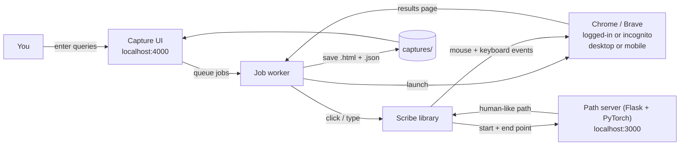
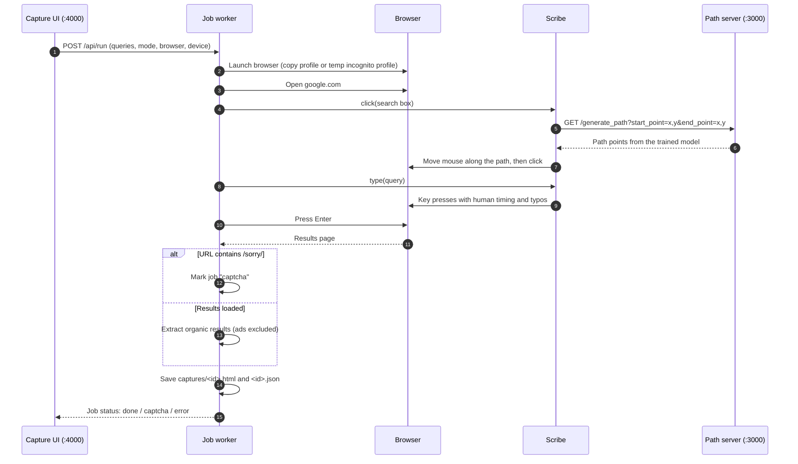
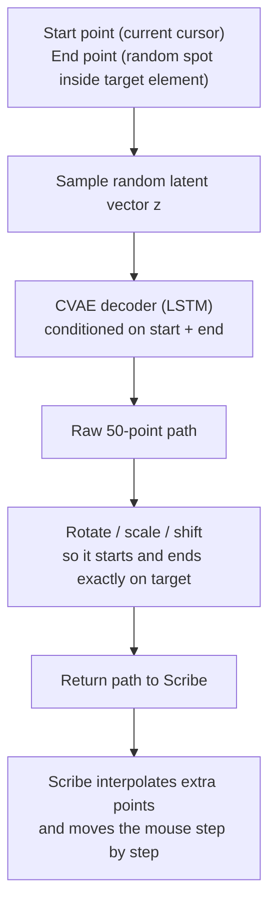
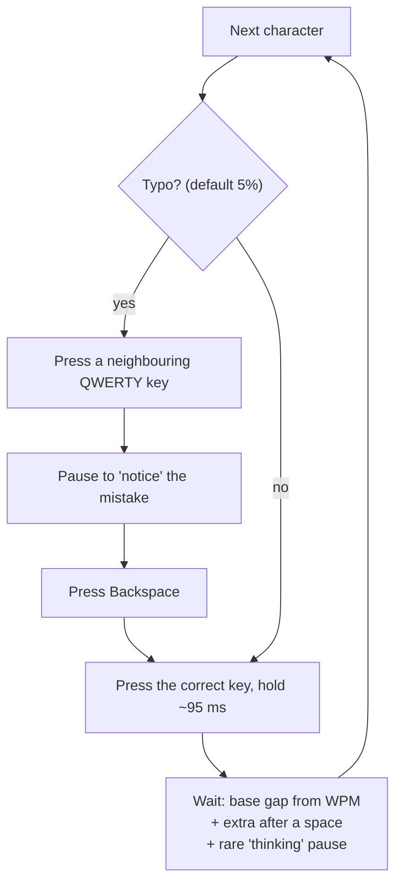

# Google-Search-Automation-Bypass-Captcha

<p align="center">
  
</p>

Automate Google searches in a real browser while behaving like a human, so Google is far less likely to flag the session and show a CAPTCHA. Every search is saved (full page HTML + parsed results) and can be browsed from a small local web UI.

It works by combining three things:

1. **Human-like mouse movement.** A trained ML model (CVAE + LSTM) generates realistic cursor paths, instead of the instant straight-line jumps typical of bots.
2. **Human-like typing.** It types at a set WPM with natural rhythm, pauses between words, occasional "thinking" pauses, and realistic typos that get corrected with Backspace.
3. **A real browser.** It runs your installed Chrome or Brave, either with a copy of your logged-in profile (cookies, Google sign-in, extensions) or a fresh incognito profile, with Puppeteer's automation flags removed. It can also emulate a mobile phone (Pixel 8).

> **Note:** This lowers the chance of a CAPTCHA a lot, but cannot guarantee zero CAPTCHAs. Google also looks at IP reputation and request volume. When a CAPTCHA does appear, the run is marked `captcha` instead of failing silently.

---

## How it works

### Big picture



### One search, step by step



### How a mouse path is generated



Because `z` is random, the path is different every time, even between the same two points.

### How typing is made human-like



---

## Project structure

```
.
├── puppeteer-scribe/          # Main automation project
│   ├── index.ts               # Scribe library: human-like click(), type(), moveMouse()
│   ├── server/server.py       # Path server: serves the trained model on :3000
│   ├── model/                 # Trained model file(s) (*.pt), newest is used
│   ├── ui/
│   │   ├── server.ts          # Capture UI + job worker on :4000
│   │   ├── public/            # UI pages (run queries, view sources)
│   │   └── captures/          # Saved searches (git-ignored)
│   └── examples/              # Stand-alone scripts (see below)
├── model/                     # Scripts to train / test your own model
├── ui/                        # Next.js app to record real mouse movements (training data)
└── GOOGLE_ADS_VISIBILITY_REQUIREMENT.md   # Use case: tracking Google ads per category
```

---

## Setup

**Requirements:** Node.js 18+, Python 3.10+, and Google Chrome and/or Brave installed (macOS paths by default).

```bash
git clone https://github.com/Ankulraja/Google-Search-Automation-Bypass-Captcha.git
cd Google-Search-Automation-Bypass-Captcha

# Python env for the path server
python3 -m venv .venv
.venv/bin/pip install -r puppeteer-scribe/server/requirements.txt

# Node dependencies
cd puppeteer-scribe
npm install
```

Make sure there is a trained model (`*.pt`) in `puppeteer-scribe/model/`. See [Training your own model](#training-your-own-model) to create one.

---

## Usage

### 1. Start the path server (terminal 1)

```bash
cd puppeteer-scribe
../.venv/bin/python server/server.py      # runs on http://localhost:3000
```

### 2. Start the capture UI (terminal 2)

```bash
cd puppeteer-scribe
npx ts-node ui/server.ts                  # runs on http://localhost:4000
```

Open **http://localhost:4000** and:

1. Paste your queries, one per line. You can add a numeric tag in front, e.g. `9898  Massage Chair`.
2. Choose the **browser** (Chrome / Brave), **mode** (logged-in profile / incognito) and **device** (desktop / mobile).
3. Click run. Jobs go through the queue one by one, with status `queued → running → done / captcha / error`.
4. Open **http://localhost:4000/source** to browse saved pages, view the rendered page or the raw/parsed HTML source, or download it.

| Mode | What it does |
|---|---|
| **Logged-in** | Copies your real browser profile to a temp folder (your original profile is never touched) and uses it, so Google sees your normal cookies and sign-in. Usually gives the fewest CAPTCHAs. |
| **Incognito** | Fresh empty profile for each run, deleted afterwards. Each query gets its own private context. |

### 3. Or run an example script

```bash
cd puppeteer-scribe
npm test local-demo.ts         # offline demo page: watch the mouse + typing
npm test google-search.ts      # Google search in Puppeteer's Chromium
npm test brave-google.ts       # Google search in Brave (temp profile), prints results
npm test brave-logged-in.ts    # Google search in a copy of your Brave profile
```

Useful environment variables:

| Variable | Used by | Default |
|---|---|---|
| `QUERY` | brave examples | `mobile phone` |
| `PROFILE` | brave-logged-in | `Default` |
| `HOLD_MS` | brave-logged-in | `120000` (how long the window stays open) |
| `UI_PORT` | capture UI | `4000` |
| `CHROME_PATH` / `BRAVE_PATH` | capture UI | standard macOS app paths |

### Use the library in your own script

```ts
import puppeteer from "puppeteer";
import Scribe from "./index";

const browser = await puppeteer.launch({ headless: false, defaultViewport: null });
const page = await browser.newPage();
const scribe = new Scribe(page, { visualize: true, wpm: 80 });

await page.goto("https://www.google.com");
await scribe.click('textarea[name="q"]');               // human-like mouse path + click
await scribe.type("industrial air compressor", {        // human-like typing
  wpm: 60,
  typoChance: 0.05,
});
await page.keyboard.press("Enter");
```

`Scribe` options: `apiUrl` (path server, default `http://localhost:3000/generate_path`), `wpm`, `clickDelay`, `moveDelay`, `visualize` (shows a dot where the cursor is), `startPosition`.

---

## Training your own model

1. Collect mouse data with the Next.js app in `ui/` (`npm i && npm run start`), or use the public dataset: https://www.kaggle.com/datasets/sameelarif/mouse-movement-between-ui-elements
2. Put the data file in `model/` and set `DATA_FILE` in `model/train.py`.
3. Train:
   ```bash
   pip install -r model/requirements.txt
   cd model && python train.py
   ```
4. Copy the new file from `model/models/` into `puppeteer-scribe/model/`. The path server automatically uses the newest one.

---

## Credits & license

Built on top of [Scribe](https://github.com/sameelarif/scribe) by Sameel Arif, which provides the mouse-movement model, training scripts and data-collection UI. This project adds human-like typing, real-browser (Chrome/Brave) profile support, mobile emulation, CAPTCHA detection and the capture UI.

Licensed under [Creative Commons Attribution-NonCommercial 4.0](LICENSE) (inherited from the original project). Commercial use requires permission from the original author.

Use responsibly and in line with the terms of the websites you automate.
